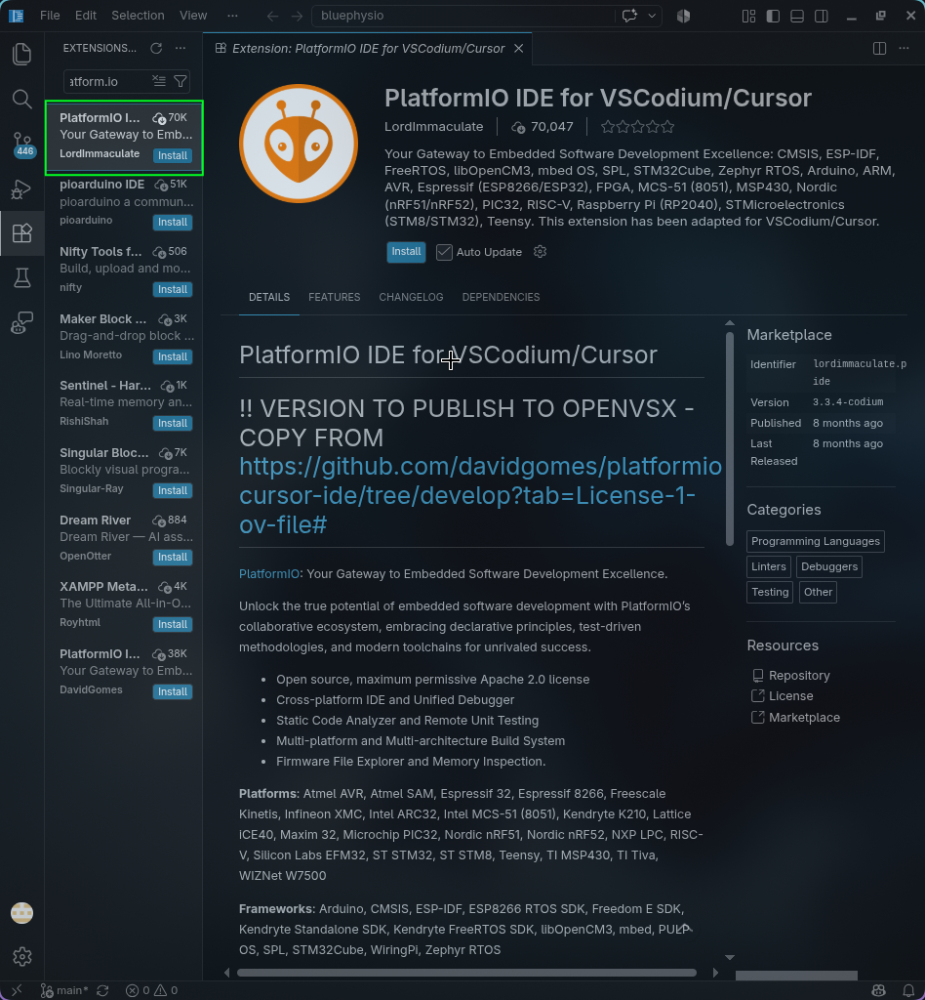
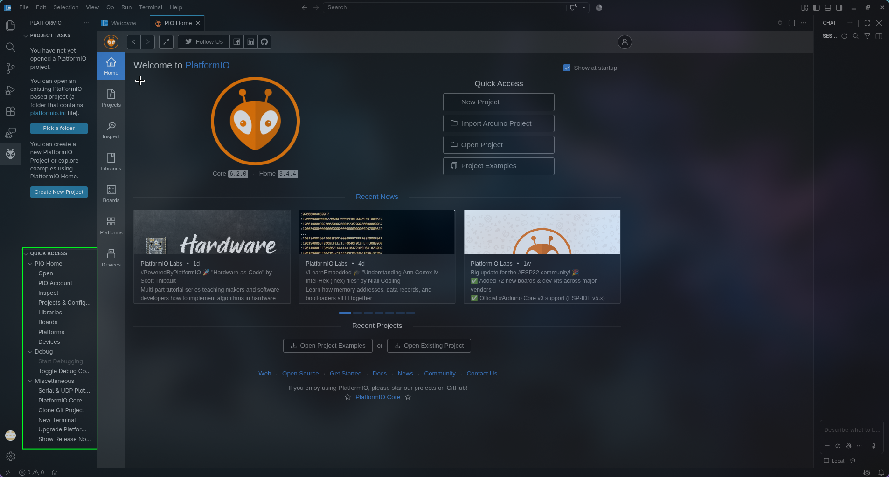
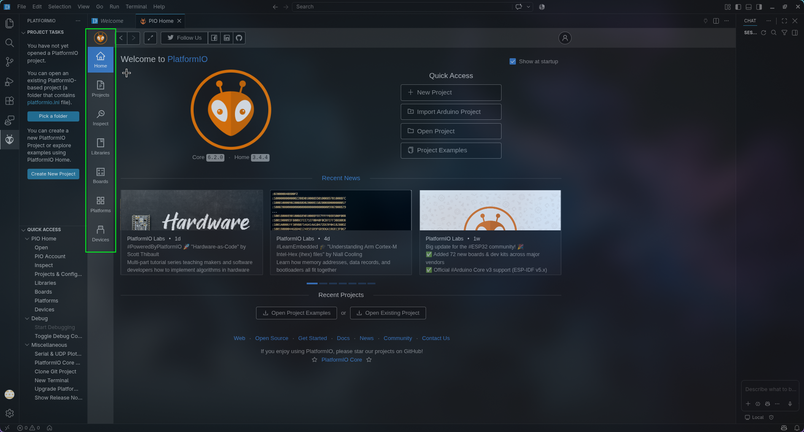

# 🛠️ Guía de Instalación y Configuración de PlatformIO IDE en VS Code

> **Recurso Transversal LINUDECX** <br>
> *Configuración de entorno de desarrollo embebido para microcontroladores ESP32 WROOM y ESP32-CAM.*

---

## 📋 Tabla de Contenido
1. [¿Qué es PlatformIO y cómo funciona?](#1-qué-es-platformio-y-cómo-funciona)
2. [Paso a Paso de Instalación](#2-paso-a-paso-de-instalación)
   - [Requisitos previos en Linux](#requisitos-previos-en-linux)
   - [Paso 1: Instalación de la extensión](#paso-1-instalación-de-la-extensión-platformio-ide)
   - [Paso 2: Herramientas Rápidas (Quick Access y Debugging)](#paso-2-herramientas-rápidas-quick-access-y-debugging)
   - [Paso 3: Abrir o Crear un Nuevo Proyecto](#paso-3-abrir-o-crear-un-nuevo-proyecto)
   - [Paso 4: Navegación de Herramientas y Dispositivos](#paso-4-navegación-de-herramientas-boards-librerías-plataformas-y-puertos)
3. [Configuración para ESP32 WROOM](#3-configuración-para-esp32-wroom)
4. [Configuración para ESP32-CAM (AI-Thinker)](#4-configuración-para-esp32-cam-ai-thinker)
5. [Configuración Dual en un mismo Proyecto (`platformio.ini`)](#5-configuración-dual-en-un-mismo-proyecto-platformioini)

---

## 1. ¿Qué es PlatformIO y cómo funciona?

**PlatformIO** es un ecosistema profesional de desarrollo embebido multiplataforma y de código abierto. A diferencia del IDE tradicional de Arduino, PlatformIO desacopla el código fuente del hardware mediante un modelo de configuración declarativo:

* **Gestión centralizada (`platformio.ini`)**: Define dependencias de librerías, toolchains, parámetros de compilación, particiones de memoria y opciones de carga en un solo archivo reproducible.
* **Aislamiento de dependencias**: Cada proyecto descarga y mantiene sus propias librerías y versiones de compilador sin contaminar el entorno global del sistema operativo.
* **Integración con VS Code**: Provee autocompletado inteligente (IntelliSense real), depuración paso a paso (debugging), navegación de código y terminal serie integrado con alta velocidad de compilación.

```
+-------------------------------------------------------------+
|                     Visual Studio Code                      |
|  +-------------------------------------------------------+  |
|  |                    PlatformIO IDE                     |  |
|  |  +-----------------+  +----------------------------+  |  |
|  |  |    PIO Home     |  |   Quick Access / Tasks     |  |  |
|  |  +-----------------+  +----------------------------+  |  |
|  +-------------------------------------------------------+  |
+------------------------------+------------------------------+
                               |
                               v
                     [ platformio.ini ]
                (Board, Framework, Librerías)
                               |
             +-----------------+-----------------+
             |                                   |
             v                                   v
    [ ESP32 WROOM-32 ]                   [ ESP32-CAM ]
  (esp32dev / 4MB Flash)             (AI-Thinker / PSRAM)
```

---

## 2. Paso a Paso de Instalación

### Requisitos previos en Linux
En distribuciones basadas en Arch Linux u otras derivadas, asegurate de tener Python instalado y permisos de lectura/escritura sobre los puertos serie USB (`/dev/ttyUSB*` / `/dev/ttyACM*`):

```bash
sudo usermod -aG uucp $USER
```
*(Es necesario reiniciar el sistema o cerrar la sesión para que el cambio de grupo surta efecto).*

---

### Paso 1: Instalación de la extensión PlatformIO IDE
1. Abrí **Visual Studio Code**.
2. Dirigite a la pestaña de **Extensiones** en la barra lateral izquierda o presioná el atajo `Ctrl + Shift + X`.
3. En el campo de búsqueda escribí `PlatformIO IDE`.
4. Ubicá la extensión oficial desarrollada por **PlatformIO** y hacé clic en **Install**.
5. Esperá a que PlatformIO complete la descarga del Core y sus herramientas base. Al finalizar, aparecerá el ícono del alien en la barra de actividad lateral.



---

### Paso 2: Herramientas Rápidas (Quick Access y Debugging)
Una vez instalada la extensión:
1. Hacé clic en el ícono de **PlatformIO** (el alien/hormiga) en la barra de actividad izquierda.
2. Se desplegará el panel lateral con las siguientes secciones:
   * **Quick Access**: Acceso directo a *PIO Home* (Open, Platforms, Devices), documentación y soporte.
   * **Project Tasks**: Comandos de ciclo de vida del firmware como **Build** (compilar), **Upload** (subir código), **Monitor** (consola serie), **Upload and Monitor**, y **Clean**.
   * **Debug**: Opciones para iniciar sesiones de depuración en placas con soporte JTAG.



---

### Paso 3: Abrir o Crear un Nuevo Proyecto
Para comenzar con un firmware:
1. Dentro de *Quick Access*, hacé clic en **PIO Home > Open**.
2. En la pantalla principal de PIO Home disponés de las acciones principales de gestión:
   * **New Project**: Inicia el asistente interactivo de creación de proyectos.
   * **Open Project**: Abre un proyecto PlatformIO existente.
   * **Import Arduino Project**: Convierte un sketch `.ino` de Arduino al estándar PlatformIO.
   * **Project Examples**: Proyectos de referencia oficiales.



---

### Paso 4: Navegación de Herramientas (Boards, Librerías, Plataformas y Puertos)
En el menú lateral de **PIO Home** contás con herramientas clave para la gestión del hardware:
* **Boards**: Buscador exhaustivo de microcontroladores soportados (especificaciones, reloj, tamaño de flash, pinouts).
* **Platforms**: Gestor de plataformas de hardware instaladas (por ejemplo, *Espressif 32* o *Atmel AVR*).
* **Libraries**: Catálogo centralizado para buscar librerías e instalarlas de forma declarativa.
* **Devices**: Monitor de puertos serie USB detectados en el sistema en tiempo real.


---

## 3. Configuración para ESP32 WROOM

El módulo **ESP32 WROOM-32** (o *ESP32 Dev Module*) es la placa estándar para desarrollo general de IoT con conectividad Wi-Fi y Bluetooth.

### Configuración en `platformio.ini`

En la raíz del proyecto, configurá el archivo `platformio.ini` con el siguiente entorno:

```ini
[env:esp32dev]
platform = espressif32
board = esp32dev
framework = arduino

; Velocidad del monitor serie
monitor_speed = 115200

; Velocidad de flasheo (921600 para subida rápida en conversores USB integrados)
upload_speed = 921600

; Filtros para decodificar excepciones del ESP32 en consola
monitor_filters = esp32_exception_decoder, time
```

### Código de prueba (`src/main.cpp`)

Cumpliendo con los estándares de nomenclatura (camelCase en funciones y variables, UPPER_CASE en constantes) y documentación Doxygen del semillero:

```cpp
#include <Arduino.h>

/**
 * @file main.cpp
 * @brief Programa de verificación para microcontrolador ESP32 WROOM.
 * @author Semillero LINUDECX
 */

/** @brief Pin GPIO conectado al LED de estado de la placa. */
constexpr uint8_t LED_PIN = 2;

/** @brief Intervalo de parpadeo en milisegundos. */
constexpr uint32_t BLINK_INTERVAL_MS = 1000;

/**
 * @brief Configuración inicial del microcontrolador.
 * Inicializa la velocidad del puerto serie y el modo del pin del LED.
 */
void setup() {
    Serial.begin(115200);
    pinMode(LED_PIN, OUTPUT);
    Serial.println(F("\n[LINUDECX] ESP32 WROOM inicializado correctamente."));
}

/**
 * @brief Bucle principal de ejecución.
 * Alterna el estado del LED y envía el registro por puerto serie.
 */
void loop() {
    digitalWrite(LED_PIN, HIGH);
    Serial.println(F("Estado: LED Encendido"));
    delay(BLINK_INTERVAL_MS);

    digitalWrite(LED_PIN, LOW);
    Serial.println(F("Estado: LED Apagado"));
    delay(BLINK_INTERVAL_MS);
}
```

---

## 4. Configuración para ESP32-CAM (AI-Thinker)

El módulo **ESP32-CAM** cuenta con sensor de cámara OV2640 y memoria RAM pseudoestática externa (PSRAM de 4MB). Debido a esto, requiere parámetros de compilación y particionado específicos.

### Consideraciones técnicas críticas
1. **Partición de Flash**: El firmware que incluye soporte Wi-Fi y la librería `esp_camera` supera 1.3 MB. El esquema de partición por defecto (1.2 MB de app) produce error de desbordamiento. Se debe usar la tabla `huge_app.csv`.
2. **Activación de PSRAM**: La memoria PSRAM es obligatoria para capturar resoluciones superiores a CIF/VGA sin agotar el heap interno.
3. **Alimentación y Flasheo Directo**: Cuando la placa se conecta mediante su base programadora con cable **USB Tipo A**, los pines DTR y RTS controlan el circuito de auto-reset automáticamente. No es necesario realizar ningún puente manual entre pines para entrar en modo bootloader. Se recomienda conectar a un puerto USB que suministre al menos 5V y 2A para prevenir reinicios por *brownout* al inicializar la cámara.

### Configuración en `platformio.ini`

```ini
[env:esp32cam]
platform = espressif32
board = esp32cam
framework = arduino

monitor_speed = 115200
upload_speed = 115200

; Esquema de partición con 3.1MB para la aplicación
board_build.partitions = huge_app.csv

; Flags del compilador para soporte y corrección de caché de PSRAM
build_flags = 
    -DBOARD_HAS_PSRAM
    -mfix-esp32-psram-cache-issue

; Filtros de depuración del monitor serie
monitor_filters = esp32_exception_decoder, default
```

### Código de prueba (`src/main.cpp`)

```cpp
#include <Arduino.h>
#include "esp_camera.h"

/**
 * @file main.cpp
 * @brief Verificación de hardware y memoria PSRAM para ESP32-CAM.
 * @author Semillero LINUDECX
 */

/**
 * @brief Inicializa los periféricos y verifica la disponibilidad de memoria PSRAM.
 */
void setup() {
    Serial.begin(115200);
    delay(1000);
    Serial.println(F("\n[LINUDECX] ESP32-CAM Inicializando..."));

    if (psramFound()) {
        const uint32_t totalPsramBytes = ESP.getPsramSize();
        Serial.printf("PSRAM detectada con éxito. Tamaño total: %u bytes\n", totalPsramBytes);
    } else {
        Serial.println(F("ALERTA: Memoria PSRAM externa no detectada."));
    }
}

/**
 * @brief Reporta periódicamente el estado de la memoria dinámica libre.
 */
void loop() {
    const uint32_t freeHeapBytes = ESP.getFreeHeap();
    const uint32_t freePsramBytes = ESP.getFreePsram();

    Serial.printf("Heap libre: %u bytes | PSRAM libre: %u bytes\n", 
                  freeHeapBytes, freePsramBytes);
    delay(5000);
}
```

---

## 5. Configuración Dual en un mismo Proyecto (`platformio.ini`)

Si tu solución requiere trabajar con ambos microcontroladores en el mismo repositorio, podés definir ambos entornos en el mismo archivo y seleccionar el que desees flashear:

```ini
[platformio]
default_envs = esp32dev

; ----------------------------------------------------------------------
; Entorno 1: ESP32 WROOM Dev Module
; ----------------------------------------------------------------------
[env:esp32dev]
platform = espressif32
board = esp32dev
framework = arduino
monitor_speed = 115200
upload_speed = 921600
monitor_filters = esp32_exception_decoder, time

; ----------------------------------------------------------------------
; Entorno 2: ESP32-CAM AI-Thinker
; ----------------------------------------------------------------------
[env:esp32cam]
platform = espressif32
board = esp32cam
framework = arduino
monitor_speed = 115200
upload_speed = 115200
board_build.partitions = huge_app.csv
build_flags = 
    -DBOARD_HAS_PSRAM
    -mfix-esp32-psram-cache-issue
monitor_filters = esp32_exception_decoder, default
```

> **Consejo LINUDECX**: Podés alternar qué entorno compilar o subir haciendo clic en el selector de entorno de la barra de estado inferior de VS Code (`env:esp32dev` o `env:esp32cam`).
